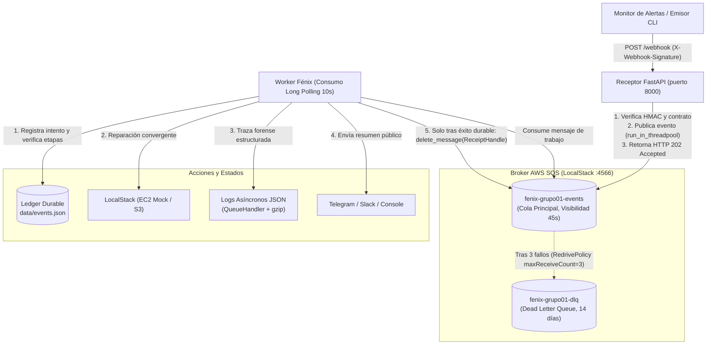

# Proyecto Fénix — Sistema de Autorreparación de Infraestructura Cloud

> **Programación para Automatización II** · UPaTeCo · 1º Año, 2º Cuatrimestre  
> Trabajo Final Integrador: Recepción de alertas de monitoreo, mensajería asíncrona mediante AWS SQS con Dead Letter Queue (DLQ), autorreparación convergente de recursos emulados en LocalStack y comunicación de resultados a canal externo.

---

## 1. Integrantes y Distribución de Roles

| Integrante | Roles Asignados | Responsabilidades Principales | Módulos a Cargo |
| :--- | :---: | :--- | :--- |
| **Silva, Augusto** | **Integrante 1, 2 y 3** | • Validación de esquema cerrado, contratos y control de tipos.<br>• Gestión de colas SQS, inventario Cloud y LocalStack.<br>• Receptor Webhook FastAPI, autenticación HMAC-SHA256 y reparación convergente. | `src/fenix/utils/validation.py`<br>`src/fenix/utils/crypto.py`<br>`src/fenix/services/events.py`<br>`src/fenix/services/sqs.py`<br>`src/fenix/services/demo.py`<br>`src/fenix/services/receiver.py`<br>`src/fenix/services/remediation.py` |
| **Tejerina, Marcela** | **Integrante 4, 5 y 6** | • Observabilidad forense, motor de logs JSON y notificaciones.<br>• Worker desacoplado con long polling, ledger `data/events.json` y confirmación ACK.<br>• Inyección de fallas en recursos y suite de pruebas automatizadas. | `src/fenix/utils/logging_json.py`<br>`src/fenix/services/notifications.py`<br>`src/fenix/services/worker.py`<br>`src/fenix/cli.py`<br>`tests/` |

---

## 2. Objetivo del Sistema

En las operaciones de nube es habitual que ocurran desvíos de configuración (por ejemplo, una máquina virtual de pruebas que queda apagada o un bucket S3 al que un usuario le quitó etiquetas obligatorias de facturación o dueño). 

El **Proyecto Fénix** implementa un circuito automatizado y desacoplado para resolver estas fallas:
1. **Recepción desacoplada:** Un monitor externo envía un webhook con una alerta en formato JSON. El receptor FastAPI autentica la petición mediante firma criptográfica **HMAC-SHA256**, valida que el recurso pertenezca al inventario del grupo y deposita la orden en una cola **AWS SQS**. Responde de inmediato **HTTP 202 Accepted**, sin ejecutar la reparación durante la petición web.
2. **Procesamiento asíncrono:** Un worker independiente consume la cola usando long polling, verifica el estado real del recurso en **LocalStack**, converge el recurso al estado deseado (arranca la instancia EC2 o restaura las etiquetas de S3) y persiste cada etapa en un ledger local (`data/events.json`).
3. **Notificación y ACK:** Una vez que el recurso fue verificado y el resultado quedó registrado, se notifica el éxito a un canal de comunicación (Telegram/Slack o consola de desarrollo). Solo después de comprobar el éxito durable, el worker envía la confirmación (**ACK**) borrando el mensaje de SQS con `delete_message(ReceiptHandle)`.
4. **Tolerancia a fallos y DLQ:** Si un mensaje presenta errores temporales, se reprograma con backoff exponencial. Si la falla es persistente o el mensaje es venenoso, la política `RedrivePolicy` de SQS lo deriva automáticamente a la **Dead Letter Queue (DLQ)** tras 3 recepciones fallidas, permitiendo que el worker continúe funcionando sin caerse.

---

## 3. Diagrama de Arquitectura



---

## 4. Prerrequisitos y Versiones

- **Sistema Operativo:** Windows 10/11.
- **Python:** Versión `3.11` o superior (probado y validado en Python `3.14.7` y `3.11`).
- **Docker Desktop:** En ejecución para levantar el contenedor de LocalStack.
- **LocalStack:** Imagen emuladora de servicios AWS (puerto `4566`).

---

## 5. Instalación y Preparación Inicial

### 5.1. Abrir la terminal y acceder a la carpeta del proyecto
Abrir **PowerShell** (o Windows Terminal) y ubicarse en la carpeta raíz del proyecto:
```powershell
cd " ...  "
```

### 5.2. Crear y activar el entorno virtual
En Windows PowerShell, habilitar la ejecución de scripts para la sesión actual y activar el entorno:
```powershell
python -m venv .venv
Set-ExecutionPolicy -Scope Process -ExecutionPolicy Bypass
.\.venv\Scripts\Activate.ps1
```
*(A la izquierda del prompt aparecerá `(.venv)` indicando que el entorno virtual está activo).*

### 5.3. Instalar dependencias
Instalar las dependencias fijadas y registrar el paquete en modo editable:
```powershell
python -m pip install --upgrade pip
pip install -r requirements-lock.txt
pip install -e .
```

### 5.4. Configurar variables de entorno (.env)
Si aún no existe el archivo `.env`, copiarlo desde la plantilla:
```powershell
Copy-Item .env.example .env
```
*(El archivo `.env` ya viene preconfigurado con las claves y parámetros necesarios para LocalStack).*

---

## 6. Guía Definitiva de Montaje y Demostración en Vivo Paso a Paso

Esta guía permite montar y probar el sistema de punta a punta desde cero (con la máquina recién encendida y terminales cerradas):

###  Requisito previo
- Tener **Docker Desktop** abierto y corriendo en Windows.

---

###  Paso 1: Abrir la terminal y levantar LocalStack
Abrir **PowerShell** y pegar este bloque de comandos:
```powershell
cd " ... "
Set-ExecutionPolicy -Scope Process -ExecutionPolicy Bypass
.\.venv\Scripts\Activate.ps1
docker compose up -d
```
*(Esperar unos segundos hasta que la consola indique `Container ... Started`)*.

---

###  Paso 2: Inicializar colas y recursos de prueba
En esa misma ventana ejecutar estos dos comandos:
1. **Crear las colas SQS:**
   ```powershell
   python -m fenix.cli init-queues
   ```
2. **Crear el servidor EC2 y el bucket S3:**
   ```powershell
   python -m fenix.cli setup-demo
   ```

---

###  Paso 3: Poner a funcionar el sistema en tiempo real (3 Pestañas)
Utilizar **3 pestañas** en Windows Terminal:

####  Pestaña 1: Iniciar el Receptor Webhook
En la pestaña actual donde se ejecutó el setup:
```powershell
python -m uvicorn fenix.services.receiver:app --host 127.0.0.1 --port 8000 --env-file .env
```

---

####  Pestaña 2: Iniciar el Worker (el que autorrepara)
1. Abrir una **2da pestaña** con el **`+`**.
2. Copiar y pegar:
   ```powershell
   cd " ... "
   Set-ExecutionPolicy -Scope Process -ExecutionPolicy Bypass
   .\.venv\Scripts\Activate.ps1
   python -m fenix.cli worker
   ```
> **Dejar esta pestaña abierta.** El worker mostrará `[WORKER] En escucha activa sobre la cola SQS... Esperando alertas.` y quedará en segundo plano esperando eventos.

---

####  Pestaña 3: Las pruebas  (Inyección, Reparación y Tests)
1. Abrir una **3ra pestaña** con el **`+`**.
2. Activar el entorno:
   ```powershell
   cd " ... "
   Set-ExecutionPolicy -Scope Process -ExecutionPolicy Bypass
   .\.venv\Scripts\Activate.ps1
   ```

Ahora ejecutar las pruebas una por una:

#####  Prueba 1: Falla y Autorreparación de Servidor EC2 (`node-01`)
```powershell
python -m fenix.cli fault node-01
python -m fenix.cli send examples/node-event.json
```

#####  Prueba 2: Falla y Autorreparación de Almacenamiento S3 (`bucket-01`)
```powershell
python -m fenix.cli fault bucket-01
python -m fenix.cli send examples/bucket-event.json
```

#####  Prueba 3: Seguridad HMAC (Rechazo de alertas falsas)
```powershell
curl.exe -X POST http://127.0.0.1:8000/webhook -H "Content-Type: application/json" -d "{\"test\": 1}"
```

#####  Prueba 4: Verificación del Registro de Auditoría (Ledger en disco)
```powershell
Get-Content data\events.json
```

#####  Prueba 5: Batería completa de pruebas automatizadas (Rúbrica)
```powershell
python -m pytest -v
```
---

###  Paso 4: Apagar todo al finalizar
1. En la **Pestaña 1** y **Pestaña 2**: presionar `Ctrl + C` para detener el servidor y el worker.
2. En cualquier pestaña apagar LocalStack:
   ```powershell
   docker compose down
   ```

---

## 7. Contacto

Para consultas académicas sobre el proyecto:
- **Correo electrónico:** [augusto.tomas779@gmail.com](mailto:augusto.tomas779@gmail.com)
